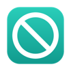
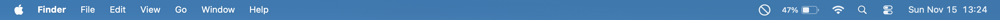
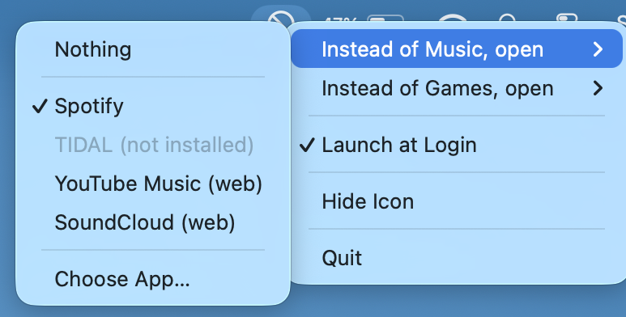
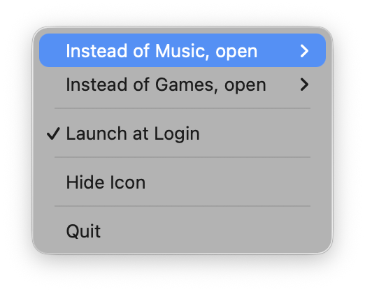
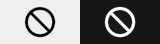
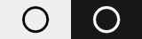

[](https://github.com/zemendes1/nope)

[](https://github.com/zemendes1/nope/releases/latest)
[](https://github.com/zemendes1/nope/releases)
[](https://github.com/zemendes1/nope/blob/master/LICENSE)
[](https://github.com/sponsors/zemendes1)

# nope

nope is a macOS menu bar app that stops built-in apps you never use, like Apple Music or Games, from launching.

Launch nope and those apps won't be able to open, even when macOS tries to open them on its own, for example when your Bluetooth headphones reconnect.

Left-click the menu bar icon to turn it on or off.

nope is based on [noTunes](https://github.com/tombonez/noTunes) by Tom Taylor.





## Installation

### Homebrew

```bash
brew install --cask zemendes1/tap/nope
```

### Direct Download

Download the latest release from the [Releases page](https://github.com/zemendes1/nope/releases/latest), unzip it and move `nope.app` to Applications.

### First launch

nope isn't notarized by Apple yet, so macOS blocks it the first time you open it. Go to **System Settings → Privacy & Security**, scroll down and click **Open Anyway** next to nope. After that it opens normally.

## Usage

### Launch at login

Right-click or control-click the menu bar icon and click **Launch at Login**. Click it again to turn it off.



### Toggle nope

Left click the menu bar icon to toggle between its active states.

**Enabled (prevents iTunes/Music from opening)**



**Disabled (allows iTunes/Music to open)**



### Open something else instead

nope can open another app or website whenever a blocked app tries to launch.

Right-click or control-click the menu bar icon, then pick from:

- **Instead of Music, open**: Spotify, TIDAL, YouTube Music (web), SoundCloud (web), or any app via **Choose App…**
- **Instead of Games, open**: Steam, Epic Games Launcher, or any app via **Choose App…**

Apps that aren't installed are greyed out. Pick **Nothing** to turn a replacement off.

## Support

If you like my work, consider supporting me through [GitHub Sponsors](https://github.com/sponsors/zemendes1) 🩷

## License

The code is available under the [MIT License](https://github.com/zemendes1/nope/blob/master/LICENSE).
